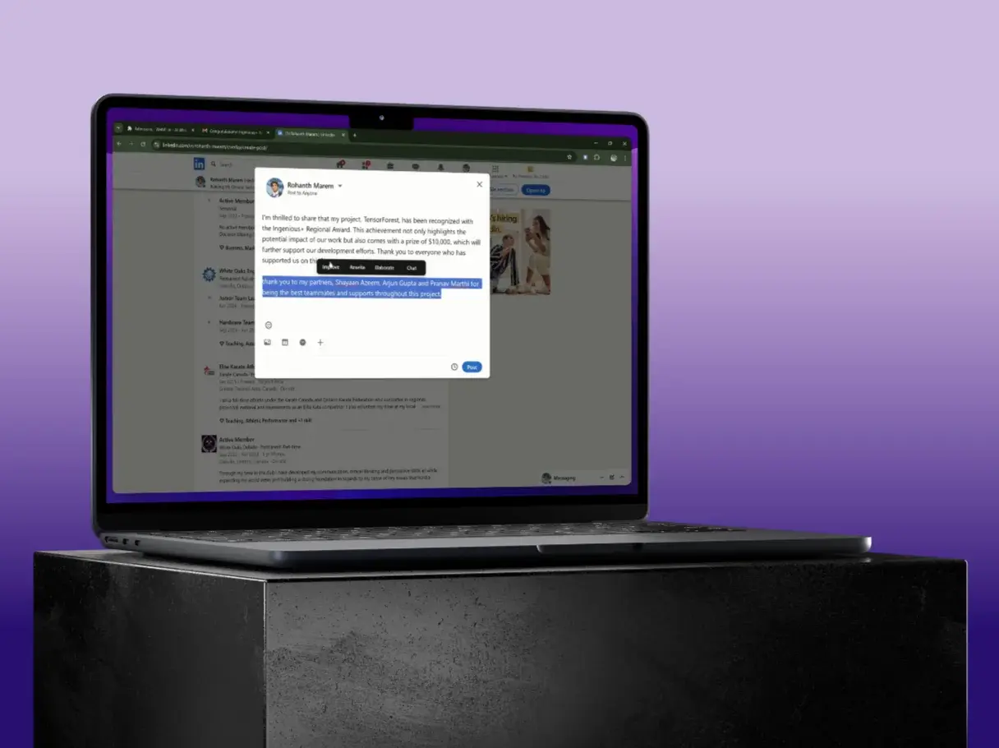

# AI Writing Toolbar

A Chrome extension that brings an AI writing assistant to any text you highlight. Select text on any page to improve, rewrite, or expand it, or open a chat sidebar that can reference your open tabs.



**Website and demo video:** https://vibetype.vercel.app

## How it works

- **Floating toolbar:** highlight text to Improve, Rewrite, Elaborate, or Chat
- **Sidebar chat:** ask about what you're reading, with context from multiple tabs
- **Content API (this repo):** turns a page's HTML into clean markdown, splits it into chunks, and uses OpenAI embeddings to find the parts most relevant to your question

## Tech

chrome extension (manifest v3, shadow dom), python, fastapi, openai embeddings

## Structure

```
main.py               FastAPI app
html_parser.py        HTML to markdown
content_chunker.py    splits content into chunks
semantic_search.py    finds relevant chunks with embeddings
api/index.py          Vercel entry point
```

The extension code is on the `Old-API-GOOD` branch.
